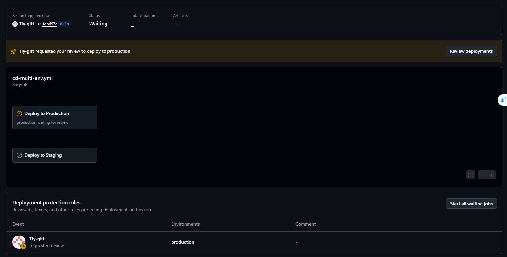
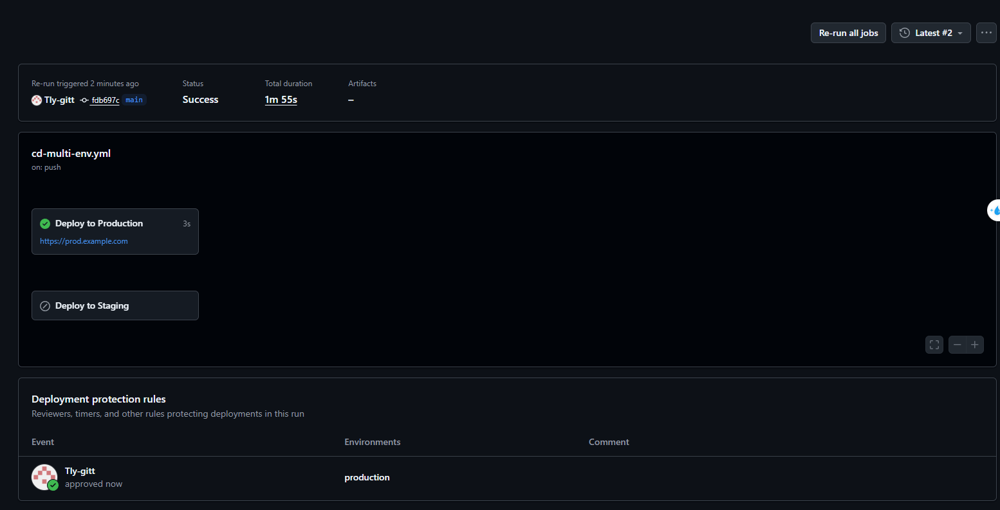

# BÁO CÁO BÀI TẬP: TÁCH BIỆT LUỒNG CI/CD ĐA MÔI TRƯỜNG VỚI GITHUB ENVIRONMENTS

## 1. Cấu hình GitHub Environments

Trên giao diện **Settings -> Environments**:
1. **Môi trường `staging`:**
   - Không cấu hình reviewer, cho phép triển khai tự động (Continuous Deployment) từ nhánh `develop`.
2. **Môi trường `production`:**
   - Kích hoạt **Required reviewers**, gán người phê duyệt là tài khoản cá nhân.
   - Mọi tiến trình deploy lên production đều bị tạm dừng cho đến khi người có thẩm quyền bấm duyệt.

---

## 2. Kịch bản Kích hoạt (`cd-multi-env.yml`)

Kịch bản định nghĩa 2 Job độc lập:
- **`deploy-staging`:**
  - Điều kiện: `if: github.ref == 'refs/heads/develop'`
  - Môi trường: `environment: staging`
- **`deploy-prod`:**
  - Điều kiện: `if: github.ref == 'refs/heads/main'`
  - Môi trường: `environment: production` (bị chặn bởi Protection Rule)

---

## 3. Kết quả Nghiệm thu (Verification)

### a. Trạng thái chờ phê duyệt (Waiting for Review)
Khi code được merge/push vào nhánh `main`, pipeline chạy và tự động tạm dừng tại Job `deploy-prod` để chờ duyệt:

```text
[ Deploy to Production ]  ──▶  Status: Waiting for review (Required Reviewer)
```



### b. Sau khi phê duyệt thành công (Approve & Deploy)
Sau khi bấm **Approve and deploy**, Job tiếp tục thực thi các bước release và kết thúc với trạng thái tích xanh:

```text
[ Deploy to Production ]  ──▶  Status: Approved by @username ──▶ Success (Active)
```



---

## 4. Kết luận
- Đã phân tách ranh giới rõ ràng giữa môi trường thử nghiệm (Staging) và môi trường vận hành thực tế (Production).
- Cơ chế bảo vệ Environment Protection Rule ngăn chặn hoàn toàn rủi ro triển khai nhầm hoặc triển khai chưa qua kiểm duyệt lên hệ thống Production.